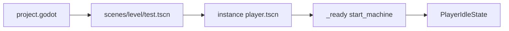
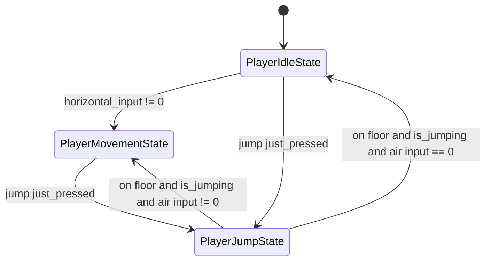

# Architecture

Source of truth: `project.godot`, `scenes/`, `scripts/`. Runtime node defaults that are **not** serialized are marked **unverified (editor)**.

## Startup flow

1. Godot 4.3 loads `project.godot`.
2. Main scene: `scenes/level/test.tscn` (`project.godot` L14).
3. `test.tscn` instances `scenes/character/player.tscn` as child `player` (L3, L15–16).
4. `PlayerController._ready()` constructs three `State` objects and calls `StateMachine.start_machine()` (`scripts/character/player_controller.gd` L17–19).
5. The machine indexes states by `get_state_name()`, sets `current_state` to the **first** array element (`PlayerIdleState`), and calls `enter()` (`scripts/state/state_machine.gd` L9–23).

No `[autoload]` section. No `change_scene` / `instantiate()` in scripts. After launch, the playable tree **is** `test.tscn`.



## Scene trees

### `scenes/level/test.tscn`

```
Node2D "Node2D"                          — no script
├─ StaticBody2D @ (178, 420)             — no script
│  └─ CollisionShape2D                   — WorldBoundaryShape2D (empty subresource L4–5)
├─ player                                — instance of player.tscn @ (197, 370)
└─ Camera2D @ (195, 363), zoom (3, 3)    — sibling of player, no script
```

No `[connection]` block. WorldBoundary `normal`/`distance`, physics layers, and Camera2D `current` are **unverified (editor)**.

### `scenes/character/player.tscn`

```
CharacterBody2D "player"
  script: scripts/character/player_controller.gd
  ├─ Node "arms"                         — empty
  ├─ AnimatedSprite2D @ (0, -16)         — SpriteFrames idle + jump; autoplay idle
  ├─ CollisionShape2D @ (-1, -20)        — CapsuleShape2D r=4, h=18
  ├─ Marker2D "r_arm" @ (-2, -15)
  │  └─ Sprite2D                         — assets/character/arms/right/r_hand1.png
  ├─ Marker2D "l_arm" @ (0, -18)
  │  └─ Sprite2D z_index=-1              — assets/character/arms/left/l_hand1.png
  └─ Node "StateMachine"
       script: scripts/state/state_machine.gd
       is_logging = true
```

FSM **state objects are not scene children**. They are created with `.new()` and stored on the machine. `State` extends `Node` (`scripts/state/state.gd` L1–2) but those instances are never `add_child`’d.

Collision layers, `motion_mode`, sprite `centered`/`offset`: **unverified (editor)**.

## Script responsibilities

| Path | Class / base | Role |
| --- | --- | --- |
| `scripts/state/state.gd` | `State` / `Node` | `enter` / `exit` / `process` / `physics_process` / `get_state_name` |
| `scripts/state/state_machine.gd` | `StateMachine` / `Node` | Registry, tick current state, `transition(name)` |
| `scripts/character/player_controller.gd` | `PlayerController` / `CharacterBody2D` | Input sample, gravity, `move_and_slide`, facing, bootstrap FSM |
| `scripts/character/player_state.gd` | `PlayerState` / `State` | Holds `player`; copies `animated_sprite` in `_init` |
| `scripts/character/player_idle_state.gd` | `PlayerIdleState` / `PlayerState` | Idle anim, jump press, start move |
| `scripts/character/player_movement_state.gd` | `PlayerMovementState` / `PlayerState` | Ground X speed |
| `scripts/character/player_jump_state.gd` | `PlayerJumpState` / `PlayerState` | Jump impulse, air X, land |

### Important methods

- `PlayerController._physics_process` — `horizontal_input`, gravity, `move_and_slide` (L22–28).
- `PlayerController.handle_facing` — flip sprites; `r_arm.position.x` ±2 (L31–50).
- `StateMachine.start_machine` / `_process` / `_physics_process` / `transition` (L9–58).
- State `process` vs `physics_process` — jump **press** is in `process`; X and landing are in `physics_process`.

## State machine transitions

Only three states exist. Start: `PlayerIdleState`.



Missing in code: **Movement → Idle**. Same-state `transition` is a no-op (`state_machine.gd` L40–41). Unknown names `push_error` (L36–38).

Details: [GAMEPLAY_SYSTEMS.md](GAMEPLAY_SYSTEMS.md).

## Signals

None. No `signal` in `.gd`, no `.connect()`, no `[connection]` in `.tscn`. Coupling is node paths, `class_name` types, and shared `player` references.

## Autoloads

None for gameplay. `editor/version_control/autoload_on_startup=true` (`project.godot` L20–21) is the **editor Git plugin**, not a game singleton.

## Resources

Referenced by `player.tscn`:

- Scripts: `player_controller.gd`, `state_machine.gd`
- Textures: `assets/character/idle.png`, `jump.png`, `arms/right/r_hand1.png`, `arms/left/l_hand1.png`

`project.godot` icon: `icon.svg`.

Import-only, unused by scenes/scripts: left/right `jab1`, `l_hook1`/`r_hook1`, `l_uppercut1`/`r_uppercut1`.

## Dependencies

**Node paths** (`player_controller.gd` L10–15) must match `player.tscn` names:

`$AnimatedSprite2D`, `$StateMachine`, `$r_arm`, `$l_arm`, `$r_arm/Sprite2D`, `$l_arm/Sprite2D`

`$arms` is unused.

**Settings:** `physics/2d/default_gravity` is read at runtime (L8) and is **not** set in `project.godot` (engine default; **unverified** numeric value).

**Input names:** `move_left`, `move_right`, `jump`.

**Animation names:** `"idle"`, `"jump"` (must match SpriteFrames).

**Class-name graph:** controller constructs idle/movement/jump; those call `state_machine.transition(...)` using `state_name` or the string `"PlayerJumpState"`.
